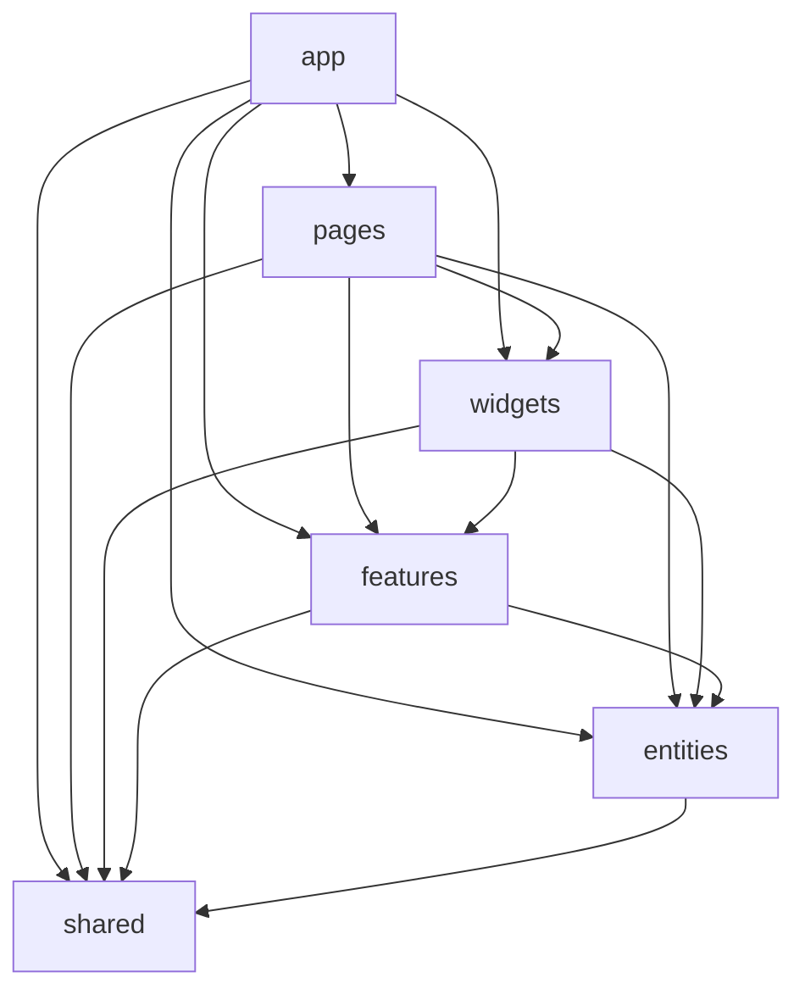

# vue-lottery-app

Лабораторні №4-6: застосунок на Vue 3 (Composition API + TypeScript).

- **ЛР5** (`feature/routing`): vue-router, патерн Repository, авторизація JWT, VeeValidate.
- **ЛР6** (`feature/fsd`): архітектура Feature-Sliced Design, Pinia-стори, PrimeVue + обгортки в `shared/ui`.

## Запуск

```bash
npm install
cp .env.example .env   # адреса API (VITE_API_URL)
npm run dev            # http://localhost:5173
npm run build          # перевірка типів (vue-tsc) + збірка + 404.html для gh-pages
npm run lint           # ESLint: style guide Vue + правила FSD
npm run lint:fsd       # лише правила FSD (eslint-plugin-boundaries)
npm run format         # Prettier
npm run deploy         # збірка і публікація dist у гілку gh-pages
```

Тестовий акаунт для входу: `emilys` / `emilyspass` ([DummyJSON](https://dummyjson.com/docs)).

## Архітектура: Feature-Sliced Design

```
src/
├── app/                 # ініціалізація: main.ts, App.vue, providers, layouts, styles
│   ├── providers/
│   │   ├── router/      # createRouter, routes, guards
│   │   ├── services.ts  # реєстрація UserService / AuthService у ServiceProvider
│   │   ├── ui.ts        # PrimeVue: тема, ToastService (єдине місце підключення UI-бібліотеки)
│   │   ├── pinia.ts     # Pinia + pinia-plugin-persistedstate
│   │   ├── auth-bridge.ts, theme.ts
│   ├── layouts/         # DefaultLayout, AuthLayout
│   └── styles/
├── pages/               # home, about, users, user-details, user-create, login, not-found
├── widgets/             # app-header (AppHeader, AppNavigation, AppLogo), users-table
├── features/            # auth, user-form, delete-user, theme-switcher
├── entities/            # user (types, UserService, store), session (types, AuthService, store)
└── shared/              # api (http-client, interfaces, ServiceProvider), ui (App* обгортки),
                         # lib, config
```

### Діаграма залежностей шарів

Стрілка означає «може імпортувати». Модуль залежить лише від шарів **нижче** за себе;
слайси одного шару не імпортують один одного; між слайсами — тільки через `index.ts` (Public API).



### Repository у структурі FSD

| Частина | Розташування |
| --- | --- |
| HTTP-клієнт, інтерфейси `Readable`, `Pageable`, `Creatable`, `Editable`, `Deletable` | `shared/api` |
| `User`, `CreateUserDto`, `UpdateUserDto` | `entities/user/model` |
| `UserService` | `entities/user/api` |
| `AuthService`, `AuthRepository` | `entities/session/api` |
| `ServiceProvider` (універсальний реєстр `register` / `get`) | `shared/api` |
| Реєстрація сервісів | `app/providers/services.ts` |

### Перевірка правил FSD

`eslint-plugin-boundaries` (`eslint.fsd.config.js`) перевіряє:

1. напрямок залежностей між шарами (`boundaries/element-types`);
2. заборону глибоких імпортів - лише Public API `index.ts` (`boundaries/entry-point`);
3. (окремо) компоненти PrimeVue імпортуються лише в `shared/ui` та `app/providers/ui.ts`
   (`no-restricted-imports`).

## Збереження стану: вручну vs pinia-plugin-persistedstate

| | Вручну (`session.store.ts`) | Плагін (`theme.store.ts`) |
| --- | --- | --- |
| Код | `loadSession()` при створенні + `watch(..., { deep: true })` + `saveSession()` | один рядок `persist: { key, pick: ['mode'] }` |
| Гнучкість | повний контроль: валідація даних (`isSession`), очищення при виході, власний формат | налаштування через опції (`pick`, `omit`, `storage`, `serializer`) |
| Безпека типів | перевіряємо структуру з `localStorage` самі | довіряє збереженим даним (потрібна міграція при зміні форми стану) |
| Підходить для | чутливих даних (токени), складної логіки | простих налаштувань (тема, фільтри) |

Токени сесії залишено з ручною реалізацією: потрібна перевірка структури й повне очищення при
виході; тему збережено плагіном - вона проста й не потребує логіки.

## Висновки

_(додайте власні нотатки)_
